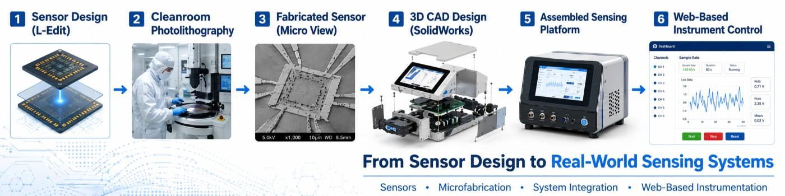

  

<h1 align="center">Kamran Bashir Taas</h1>

<strong>Biosensors &amp; Scientific Instrumentation Engineer | Electrical Engineering PhD Researcher</strong>

MEMS &amp; Semiconductor Fabrication · Embedded Systems · Mechanical Design &amp; Rapid Prototyping · Hardware–Software Integration

  <a href="https://scholar.google.com/citations?user=VaxZYvwAAAAJ&hl=en">Google Scholar</a> ·
  <a href="https://www.linkedin.com/in/kamran-bashir-taas-b2333a212/">LinkedIn</a> ·
  <a href="https://github.com/Kamran00786">GitHub</a>

---

## About me

I'm a **PhD researcher in Electrical Engineering at the University of Missouri** working on compact, integrated sensing and scientific-instrumentation systems. My engineering work connects **MEMS sensor fabrication, optical and electronic sensing, mechanical design, 3D printing, embedded controllers, Python-based instrument software, and experimental characterization**.

I enjoy developing the **complete instrument**, not only its software: creating CAD models, designing and fabricating supporting parts, assembling sensor and electronics hardware, building acquisition interfaces, processing measurements, and evaluating system performance.

## Featured engineering projects

### 🔬 Compact Fiber-Optic SERS Platform

*A compact fiber-optic Surface-Enhanced Raman Scattering (SERS) instrument for automated optical measurements.*

- **Instrument design and prototyping:** Designed the instrument enclosure, optical layout, mechanical mounts, and supporting assemblies using **SolidWorks and Autodesk Fusion 360**; fabricated custom **3D-printed parts** and integrated them into the instrument prototype.
- **Optics and sensing:** Integrated fiber-optic sensing hardware, optical excitation, spectrometer interfacing, and laser control. Worked on fabrication and testing of side-polished fiber-optic SERS sensors.
- **Software and acquisition:** Developed an **Intel NUC-hosted Python/Django interface** for instrument operation, spectrum acquisition, background processing, visualization, experiment management, and reporting.
- **Data analysis:** Implemented Raman signal-processing and noise-reduction workflows for experimental measurements.

**Engineering focus:** Fiber-optic biosensing · Raman spectroscopy · 3D CAD · 3D printing · Optical instrumentation · Python/Django

### ⚡ Compact Impedance Sensing System Platform

*A compact impedance-based sensing instrument integrating MEMS sensors, embedded electronics, and automated measurement software.*

- **Instrument design and assembly:** Modeled the instrument enclosure and component arrangement in **SolidWorks and Autodesk Fusion 360**; developed **3D-printed supporting components** for prototyping and assembled the sensing hardware into a compact system.
- **Sensing hardware:** Designed a multi-sensor contact fixture and integrated MEMS impedance sensors with electronics, excitation circuitry, switching hardware, and acquisition components.
- **Embedded communication:** Developed a **Django interface on Raspberry Pi 5** that communicates over **UART** with a **Raspberry Pi 4 hardware controller**.
- **Measurement workflows:** Implemented hardware-command handling, ADC data acquisition, calibration procedures, multi-electrode experiment processing, visualization, and reports.
- **Device development:** Designed and fabricated MEMS sensor structures and evaluated measurements against a commercial impedance analyzer.

**Engineering focus:** Impedance biosensing · MEMS · 3D CAD · 3D printing · Raspberry Pi 4/5 · UART · Data acquisition

## Mechanical design, CAD & rapid prototyping

Beyond software and electronics, I work on the **physical design of scientific instruments**:

- 3D modeling and assembly design in **SolidWorks** and **Autodesk Fusion 360**.
- Instrument enclosures, optical-component mounting arrangements, sensor fixtures, and electronic-component placement.
- **3D-printed prototype components**, fit and assembly iterations, and integration of mechanical parts with sensors, optical hardware, and electronics.
- System-level packaging that accounts for instrument accessibility, alignment, connectivity, and practical assembly.

## Engineering expertise

| Domain | Tools and experience |
|:--|:--|
| **Biosensors & scientific instrumentation** | Impedance-based sensing, fiber-optic SERS, Raman spectroscopy, measurement automation, experimental characterization |
| **MEMS & semiconductor engineering** | Photolithography, thin-film deposition, sputtering, wet/dry etching, PDMS packaging, cleanroom processes |
| **Mechanical design & prototyping** | **SolidWorks, Autodesk Fusion 360, 3D CAD, 3D printing, enclosure design, mechanical assembly** |
| **Embedded systems & electronics** | Raspberry Pi 4/5, Arduino, ESP32, UART, sensor interfacing, excitation and analog-front-end prototyping |
| **Software & data acquisition** | Python, Django, FastAPI, C++, hardware–software interfaces, signal processing, visualization, experiment reporting |
| **Simulation & device design** | LTspice, COMSOL Multiphysics, KiCad, L-Edit |

## Research & publications

My research includes **MEMS-based biosensors, microfluidics, semiconductor microfabrication, impedance sensing, fiber-optic SERS, and integrated scientific instrumentation**. I contribute to research publications and collaborative device-development projects.

Read my papers and research record on **[Google Scholar](https://scholar.google.com/citations?user=VaxZYvwAAAAJ&hl=en)**.

## Career interests

I'm interested in opportunities involving **biosensors and biomedical instrumentation**, **MEMS and semiconductor engineering**, **scientific instrumentation and R&D**, and **embedded systems / hardware–software integration**.

> **Research project note:** These are collaborative research platforms. Technical descriptions reflect my contributions; sharing complete source code, design files, and measurement data may require institutional permission and removal of sensitive information.
